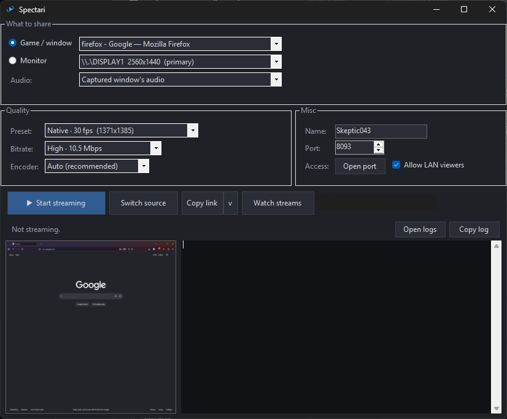
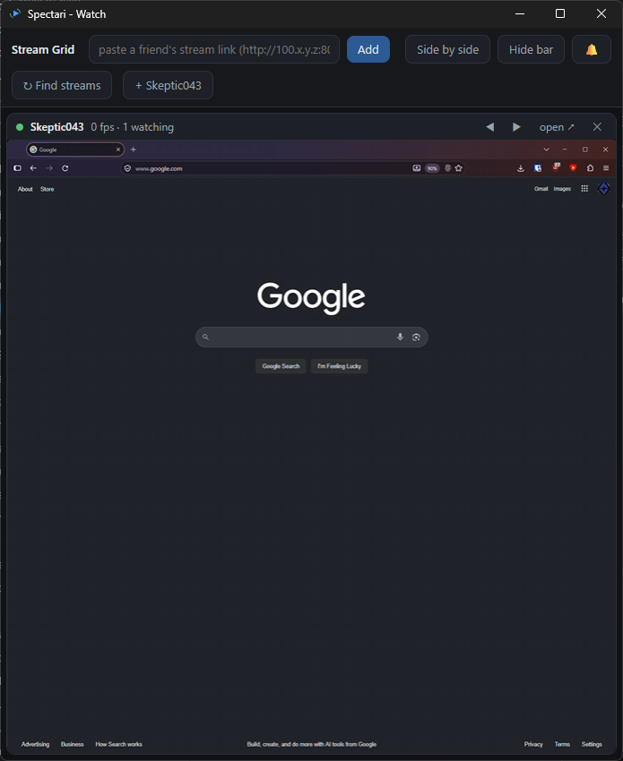

# Spectari

Spectari streams a monitor, a single window, or a capture device from a
Windows PC over Tailscale or LAN to a browser or the built-in Watch window.
It was built for private streaming in a small group. The idea is you run
one exe, the people you choose open a link, and you're done. Transport is
WebSocket and playback is MSE, with no WebRTC, signaling server, Spectari
account, or Spectari relay service.

## Screenshots

Main window with source, audio, and quality controls and a browser preview.

Watch window receiving a shared browser window.

## What it does

- Streams a whole monitor, single window, or capture device (webcam/capture
  card). Monitor capture uses desktop duplication by default and includes
  the cursor.
- Streams audio from one application you pick, all desktop audio, a capture
  device's audio input, or nothing. Mixing several specific apps is not
  supported. Capture-device shares offer the card's matching audio input
  when available, otherwise they offer the active inputs for you to choose.
- Hardware encoding on NVIDIA (NVENC), AMD (AMF), and Intel (QSV), with
  automatic fallback to CPU encoding if the GPU encoder fails or stalls.
  Presets run from 720p30 to 1440p60 plus Native, with a separate bitrate
  picker that shows the Mbps so you see the upload cost before you start.
- Each stream gets a random viewer key in its link. Eligible Tailscale
  viewers and browsers on the host itself recover rotated keys
  automatically. LAN-only viewers need the current link.
- A grid tiles several streams in one browser tab, and the built-in Watch
  window shows the same grid without a browser. Find streams looks for live
  Spectari hosts among the Tailscale peers visible to your PC. You can also
  add a stream by its copied link.
- While the app is open but not streaming, the link serves a holding page
  that connects on its own when you start. The Watch window plays one soft
  chime when a stream you are not already watching goes live. The bell in the
  grid header turns that off.

## Requirements

- Hosting: Windows 10/11, x64. Per-application audio requires
  [Windows build 20348 or later](https://learn.microsoft.com/en-us/samples/microsoft/windows-classic-samples/applicationloopbackaudio-sample/).
  On older Windows 10 builds, use desktop audio instead.
- The built-in Watch window needs the
  [Microsoft Edge WebView2 Runtime](https://developer.microsoft.com/en-us/microsoft-edge/webview2/).
  If it is missing, install it or open stream links in a browser.
- Browser playback requires Media Source Extensions and H.264/AAC support.
  Compatibility depends on the browser and device.

## Quick start

For LAN or a local test you can start right away. To let people watch over
the internet, set up Tailscale first (see the next section).

Download the Spectari application ZIP from [Releases](https://github.com/Skeptic043/spectari/releases),
extract it, and run Spectari.exe. Choose the application ZIP rather than
GitHub's source-code archives. The application package includes FFmpeg and
does not require a separate .NET installation.

1. Run Spectari.exe, pick what to share and a quality preset, click Start
   streaming.
2. Click Copy link and send it to whoever is watching. For someone on your
   LAN only, use the small arrow beside it and choose Copy LAN link.
3. If someone can't connect, click Open port. It asks for administrator
   approval and opens the stream port. To also allow LAN viewers, tick
   "Allow LAN viewers" before clicking it.

Each stream start generates a new viewer key, so the link changes when you
restart a stream. Eligible Tailscale viewers can recover the current key in
an open tab or by reopening an old link. LAN-only viewers need the fresh link.

## Watching over the internet: Tailscale

Spectari reaches remote viewers over [Tailscale](https://tailscale.com), a
mesh VPN with a free personal plan. Connections are encrypted and do not
require port forwarding. Tailscale prefers a direct connection but can fall
back to an encrypted relay, which can affect throughput and latency. See
[Tailscale connection types](https://tailscale.com/docs/reference/connection-types).

One-time setup on the hosting PC:

1. Create a free account at tailscale.com (sign in with Google, Microsoft,
   GitHub, or Apple).
2. Install Tailscale on the hosting PC and sign in. The PC gets a stable
   address that starts with 100.x.
3. Start streaming.

There are two ways for a viewer to connect.

### Viewers who just watch: share your PC with them

Best for most viewers. They keep their own Tailscale account instead of
joining yours, and they do not count against your user limit (Tailscale
labels machine sharing as beta).

1. The viewer creates their own free Tailscale account and installs Tailscale.
2. In the Tailscale admin console, find the hosting PC under Machines, pick
   Share, and send them the invite privately.
3. They accept, and your PC appears in their Tailscale as a shared machine.
4. Send them the stream link. They can open it in a browser or paste it into
   Watch. Automatic discovery and key recovery for shared-in hosts have not
   yet been verified.

Sharing is one-way: they can reach your PC, not the reverse. Remove them from
the same menu to stop.

### People who also stream: invite them to your network

Invite them into your Tailscale network instead (admin console, Users,
Invite). The free plan covers a small number of users. Find streams in the
Watch window looks for reachable Spectari hosts among visible peers, and
eligible viewers pick up rotated keys automatically. Someone already using
Tailscale elsewhere can add this network as a second account from the tray
app and switch between them.

### Other networks (advanced)

Spectari serves the stream on an IP and port, but an address must belong to
the host or use a recognized host name. Custom hostname aliases, reverse
proxies, and public port-forwarded addresses are not generally supported.
Advanced setups beyond Tailscale and LAN are unsupported. Keep the stream
on a private network rather than exposing it directly to the internet.

## Watching several streams at once

Two ways:

- In the app: run Spectari and click Watch streams. The Watch window shows a
  grid and finds live streams on your tailnet on its own. Use Find streams to
  add one by link.
- In a browser: open `http://<host-address>:<port>/grid` and paste each
  stream's full copied link into the add bar. Each live stream becomes a tile.

## Security

The model in plain terms:

- **What can reach the host.** Open port configures Windows Firewall for
  Tailscale addresses by default. LAN access is an explicit opt-in: tick
  "Allow LAN viewers" and click Open port. Existing firewall and network
  configuration still determine what can reach your PC.
- **Encryption.** Tailscale encrypts traffic between devices, including
  relayed connections. Ordinary LAN streaming uses HTTP and WebSocket
  without encryption supplied by Spectari. Use it on a network you trust.
- **What the viewer key does.** Each stream start generates a random key in
  the link. Media connections require the current key unless keyless mode is
  explicitly selected. Status metadata is public to reachable callers and never
  includes a key. The player and native discovery use a separate recovery
  endpoint for eligible Tailscale callers and callers on the host itself.
  LAN-only viewers need a fresh link after a restart. A newly opened stale
  link can load the player and recover for those callers, just like an open
  tab.
  Loading the player alone does not grant access to the stream.
- **Browser access.** The recovery endpoint does not permit cross-origin key
  reads. Player connections check the browser origin as well as the viewer key.
  Grids can still read status and embed players from other hosts. These checks
  do not authenticate native clients or prevent another page embedding a player.
- **Host names.** Generated address links, localhost, and locally established
  machine names are supported. Unrecognized custom aliases and reverse-proxy
  hostnames are refused. After upgrading the host, reload older browser pages
  and update older Watch installations to restore automatic key recovery.
- **Devices with network access.** Eligible Tailscale callers and callers on
  the host itself retain automatic key recovery. A LAN-only caller must
  supply the current link. The viewing key supplements the network boundary
  and does not replace it.
- **Tailscale is recognized by address range.** Spectari treats 100.64.0.0/10
  as Tailscale. Another VPN or a carrier-grade NAT that puts addresses from
  that range on your machine would get the same trust, so keep that in mind if
  you run one.
- **What the logs contain.** Technical diagnostics with built-in scrubbing
  for known keys and private values. Review copied logs and remove any
  remaining viewer links, addresses, names, or other private information
  before posting them publicly.

## Common issues

- **Nobody can connect, or status says "LIVE, THIS PC ONLY."** The port isn't
  open, or firewall state drifted. Click Open port and check Tailscale is
  connected on both ends. It configures one port at a time and LAN access does
  not carry across ports, so if you change the port or want to add LAN
  viewers, click Open port again on the new port with "Allow LAN viewers"
  ticked.
- **The page says the stream needs its viewer key.** The stream restarted and
  a LAN-only viewer's link went stale. Send a fresh link. Eligible Tailscale
  viewers can recover it automatically. After a host upgrade, reload older
  browser pages and update Watch if recovery stops working.
- **A fullscreen game shows a frozen frame.** Share the whole monitor instead
  of the window, or set the game to borderless. Capture behavior varies by
  game and display mode. If neither works, report the game, display mode,
  and capture source you tried.
- **Smooth on one browser, choppy on another.** Check that the browser's
  hardware acceleration is on. Add `&stats=1` to the link or click the LIVE
  badge for a diagnostics overlay.
- **A 60 fps window share shows lower source fps.** Windows window capture can
  deliver fewer fresh frames than the selected output rate. Try sharing the
  monitor or lowering the frame rate or resolution. A 60 fps setting does
  not guarantee 60 distinct captured frames each second.
- **The stream stops with "video timing overload."** The pipeline could not
  recover its timing. Lower the frame rate or resolution and try again.
- **Anything else.** Use Copy log, review and redact it, then
  [report an issue](https://github.com/Skeptic043/spectari/issues) with the
  relevant excerpt and steps to reproduce the problem. Never post a viewer
  link or key.

## FAQ

**Is it free?** Yes, for noncommercial use. See the license below.

**Does it capture my microphone?** Window and monitor shares do not offer a
microphone input. Your mic can still be audible if you route it through the
selected application or desktop output. Capture-device shares normally offer
the card's matching audio input. When no match is found, the fallback list
contains active audio inputs and can include microphones, so check what you
select.

**The stream audio is quiet or silent even though the app is playing.** Check
the selected audio source, the app's own volume, and its volume in the
Windows volume mixer. Muting or lowering the source can also affect what
viewers hear.

**How many people can watch?** The default limit is 24 viewers. The CLI can
change it with `--max-viewers`, where `0` means unlimited. Upload bandwidth
usually limits the useful number first because each viewer gets a full copy
of the stream. A 12 Mbps stream to four viewers needs roughly 48 Mbps of
upload capacity, plus network overhead. Leave some headroom and lower the
bitrate if your connection cannot keep up.

**What's the latency?** Playback is buffered for smoothness rather than the
lowest possible delay. Latency varies with the host, browser, network, and
current load.

**Can I run it from the command line?** Yes. Any argument switches to console
mode: `Spectari.exe --monitor 0 --encoder libx264 --port 8093`.

## Build from source

Needs the .NET 10 SDK and FFmpeg with H.264 encoding, AAC encoding, and MP4
muxing support. Put FFmpeg on `PATH` or place `ffmpeg.exe` next to the built
Spectari executable. From the repo root:

    dotnet run --project src/Spectari

## AI Use

AI was used to write all of the code in this project. The original concept,
design direction, testing, debugging, and release decisions are my own. If
you prefer not to use software developed with AI assistance, I understand
and respect that choice.

## Support

Spectari is a hobby project. If it's useful and you feel like saying thanks:
[ko-fi.com/skeptic043](https://ko-fi.com/skeptic043).

## License

Spectari is free for personal and other noncommercial use under
[PolyForm Noncommercial 1.0.0](LICENSE). Commercial use is not included.
Contact the maintainer through GitHub about commercial licensing.

Release packages also include an unmodified FFmpeg executable as separate
software under GPLv3 or later. The exact source, license, binary hash, and
build-provider provenance are recorded in
[the FFmpeg source manifest](packaging/ffmpeg-sources.json).
